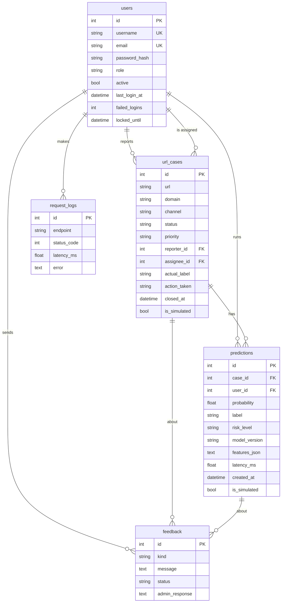

# Technical manual

Cybercrime Analytics Colombia - phishing URL case management system with an integrated
Machine Learning model.

## 1. Requirements

### Users
| Role | Description |
|---|---|
| Visitor | Reads the public PGC and CRISP-ML documentation |
| Reporter | Citizen or employee who reports suspicious links (default role) |
| Security analyst | Classifies cases with the model, reviews them and records the outcome |
| Administrator | Manages users and roles, monitoring, incidents and feedback |

### Business processes
1. **URL report:** a reporter registers a suspicious URL, the channel where it was received and a description.
2. **Classification:** an analyst runs the model; the system stores the prediction and sets the case priority.
3. **Review and resolution:** the analyst takes the case, decides the actual outcome and the action, and closes it.
4. **Follow-up:** reports, monitoring and feedback close the loop for model maintenance.

### Functional requirements
| ID | Requirement | Module |
|---|---|---|
| FR-01 | Register, log in, log out and change password | auth, account |
| FR-02 | Assign roles and activate/deactivate accounts (administrator only) | admin |
| FR-03 | Create, list, filter, view, edit and delete URL cases | cases |
| FR-04 | Classify a case with the model on the server | cases, ml |
| FR-05 | Store every prediction with date, user, result and model version | ml/inference |
| FR-06 | Record the analyst verdict, the action taken and close/reopen cases | cases |
| FR-07 | Quick URL check that can become a case | predictions |
| FR-08 | Reports, indicators and CSV export | reports |
| FR-09 | Log requests, errors and response times; detect drift | monitoring |
| FR-10 | Report incidents and feedback; administrator answers | feedback |
| FR-11 | Public documentation of the PGC and the six CRISP-ML phases | docs |

### Business rules
| ID | Rule | Where it is enforced |
|---|---|---|
| BR-01 | New accounts are always reporters; administrators are created only from the CLI | `auth.register`, `cli.create-admin` |
| BR-02 | An administrator cannot remove their own admin access and the system keeps at least one active administrator | `admin.edit_user` |
| BR-03 | A URL must use http/https, contain a domain, have no spaces and at most 2,048 characters | `ml/features.normalize_url` |
| BR-04 | A reporter cannot open two open cases for the same URL | `cases.create` |
| BR-05 | Reporters see only their own cases; analysts see all | `UrlCase.can_view` |
| BR-06 | Reporters edit/delete only cases still `new`; classified cases are deleted only by administrators | `UrlCase.can_edit/can_delete` |
| BR-07 | Status flow: new -> classified -> under review -> closed; closed -> under review (reopen) | `CaseStatus.TRANSITIONS`, `UrlCase.move_to` |
| BR-08 | Risk level: probability >= 0.80 high, >= threshold medium, otherwise low; it sets the case priority | `ml/service.risk_level`, `ml/inference.classify` |
| BR-09 | Verdict phishing -> action blocked or escalated; verdict legitimate -> dismissed | `cases.resolve` |
| BR-10 | Disagreeing with the model requires a justification (>= 10 characters) | `cases.resolve` |
| BR-11 | Predictions cannot be edited or deleted (audit trail) | no update/delete routes |
| BR-12 | Five failed logins lock the account for 15 minutes | `auth.login` |

## 2. Architecture

```
            ┌─────────────────────────── Render ───────────────────────────┐
Browser ──► │ gunicorn ─► Flask (cyberapp)                                  │
 HTTPS      │   blueprints ─► forms (WTForms + CSRF)                         │
            │   security.role_required (authorization on the server)        │
            │   ml/features ─► ml/service (joblib Pipeline) ─► ml/inference │
            │   monitoring (request log, drift, alerts)                     │
            │   SQLAlchemy ─────────────────────────────► PostgreSQL         │
            └──────────────────────────────────────────────────────────────┘
```

| Package | Responsibility |
|---|---|
| `cyberapp/__init__.py` | Application factory, extensions, blueprints, error handlers, logging |
| `cyberapp/models.py` | Database entities and business rules of the entities |
| `cyberapp/blueprints/*` | One module per functional area (routes + views) |
| `cyberapp/ml/features.py` | URL validation and feature extraction (dataset definitions) |
| `cyberapp/ml/service.py` | Model loading, contract validation and prediction |
| `cyberapp/ml/inference.py` | Inference workflow, recommendations and explanations |
| `cyberapp/ml/drift.py` | PSI, live performance and alert rules |
| `cyberapp/monitoring.py` | Request logging and the operational review |
| `cyberapp/cli.py`, `demo.py` | Administration commands and simulated data |

## 3. Database model



Tables are created with `flask --app app init-db` (`db.create_all`, idempotent).

## 4. Roles and permissions

| Function | Reporter | Analyst | Admin |
|---|:-:|:-:|:-:|
| Public documentation | ✔ | ✔ | ✔ |
| Report URL, see own cases, feedback | ✔ | ✔ | ✔ |
| See all cases, classify, review, close | | ✔ | ✔ |
| Quick check, inference history, reports, CSV, model card | | ✔ | ✔ |
| Delete classified cases | | | ✔ |
| Users and roles, monitoring, incidents | | | ✔ |

Authorization is enforced on the server with `@role_required` and per-object checks
(`can_view`, `can_edit`, `can_delete`); hidden buttons are only a convenience. The test suite
(`tests/test_roles.py`) checks every protected route for every role.

### Security measures
- Passwords hashed with Werkzeug `scrypt` and a random salt; never stored or logged in clear text.
- CSRF token on every form (Flask-WTF); logout and destructive actions only via POST.
- Session cookies `HttpOnly`, `SameSite=Lax` and `Secure` in production; `SECRET_KEY` from the environment.
- Account lockout, safe `next` redirects, generic login error messages.
- CSV export neutralizes spreadsheet formulas; the server never visits reported URLs.

## 5. Machine Learning integration

1. `normalize_url` validates the input.
2. `build_model_input` computes the features listed in `model_metadata.json`, in the same order,
   with the definitions of the training dataset. Parity: `scripts/check_feature_parity.py`.
3. `ModelService.predict` runs the scikit-learn **Pipeline**, so the preprocessing fitted on the
   training partition is applied exactly as in training.
4. `inference.classify` stores the prediction (date, user, probability, label, risk, threshold,
   model name and version, features, latency), sets the case priority and moves it to *classified*.
5. The page shows the meaning, the recommended action, the limitations and a comparison of the
   URL features with the training medians.

The model contract and the update procedure are in `models/README.md`. The model is validated
when it is loaded (features, `predict_proba`, positive class, scikit-learn version); if it is
missing or invalid, the rest of the system keeps working and the model card shows the reason.

## 6. Testing

`python -m pytest` runs the automated tests (in-memory database and a small synthetic model):
authentication and hashing, the permission matrix of every role, case CRUD and workflow,
business rules, inference storage, feature extraction, drift and request logging.

Manual acceptance checklist in the deployed environment: register -> login as each role ->
report -> classify -> review -> close -> reports -> monitoring -> restart the service and check
that the data is still there (database persistence).

## 7. Deployment

See README "Deploy to Render". `render.yaml` defines the web service (gunicorn, health check
`/healthz`) and the PostgreSQL database. Secrets are environment variables; `.env.example`
documents them without values.

## 8. Monitoring and maintenance

- **Logs:** application log on stdout (Render logs) and table `request_logs` (endpoint, status,
  response time, user, error).
- **Dashboard:** `/monitoring` (administrators): alerts, error rate, p50/p95, predictions per
  risk level, PSI per feature, live performance vs test, recent errors.
- **CLI:** `flask --app app monitoring-report --days 7` for the weekly operational review.
- **Comparison with actual outcomes:** when an analyst closes a case, the verdict is the actual
  outcome; live metrics use the latest prediction of each closed case.
- **Alert rules:** PSI > 0.25; live F1 more than 0.05 below test; live recall < 0.90 (n >= 30);
  error rate > 2%; p95 > 500 ms.
- **Versioning and retraining:** each prediction stores `model_version`. Retraining criteria and
  the update procedure are documented in CRISP-ML phase 6 and in `models/README.md`.

### Incident procedure
1. A user reports the problem ("Report a problem") or the administrator sees an alert or error.
2. The administrator acknowledges it (status *in progress*) within 2 business days.
3. Errors: reproduce with the request log, fix, add a test, redeploy. Wrong results: review the
   case, add it to the retraining set.
4. The administrator answers the user and marks the report *resolved*.
