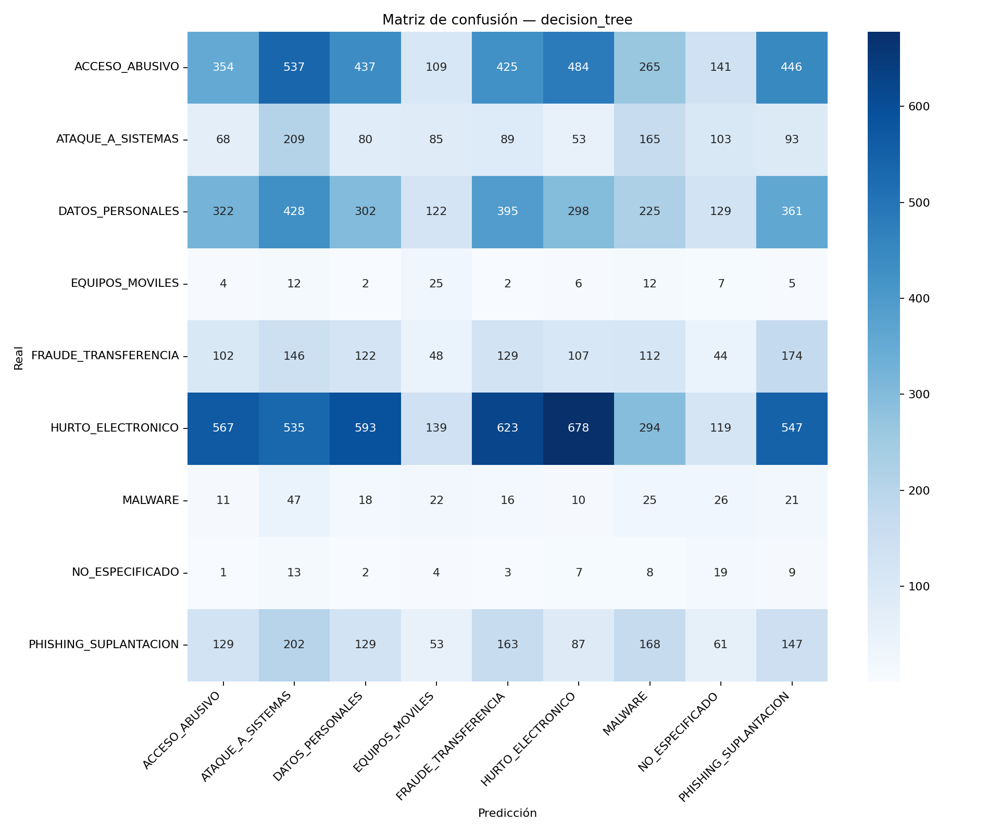
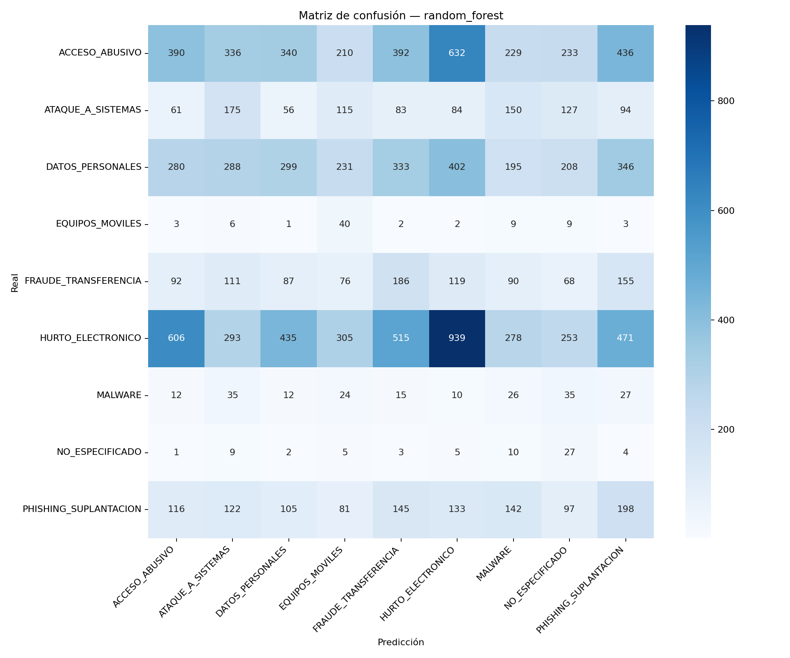
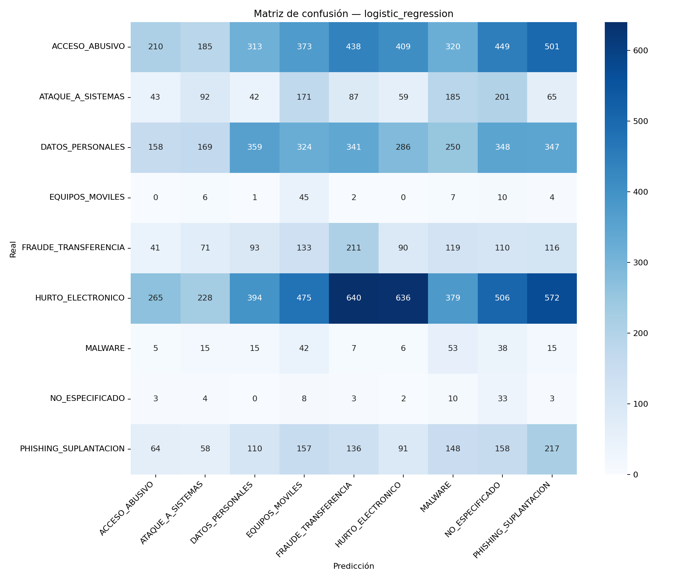
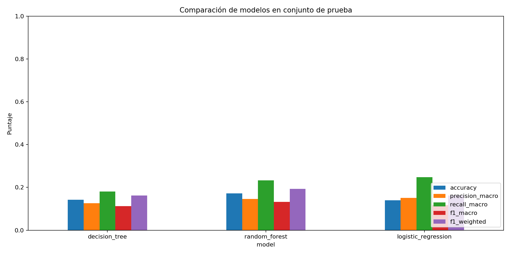

# Informe de Model Engineering

## 1. Introducción

Este trabajo entrena clasificadores para estimar la categoría de ciberdelito en el dataset procesado que sí está disponible en el repositorio. Los resultados describen clasificación de filas agregadas del dataset, no una validación de predicción operativa de incidentes individuales.

## 2. Objetivo

Comparar Decision Tree, Random Forest y Logistic Regression con la misma partición de prueba, usando pipelines de Scikit-learn y dando atención a las clases minoritarias.

## 3. Dataset

Se utilizó `data/processed/delitos_procesado.csv`, producto de `analisis/03_limpieza.py`, derivado del Excel de delitos informáticos. Tiene 66.400 filas y 20 columnas. El CSV representa filas agregadas por combinaciones de delito, periodo y territorio; `total_procesos` es el conteo agregado. En el archivo no hay valores nulos en el objetivo. Se observaron 656 nulos en `seccional` y 329 en `articulo` (985 valores faltantes en total; las columnas se solapan o no en 0-985 filas). Los predictores imputan los faltantes dentro del pipeline.

La distribución de `categoria` es: ACCESO_ABUSIVO 15.990; ATAQUE_A_SISTEMAS 4.725; DATOS_PERSONALES 12.911; EQUIPOS_MOVILES 375; FRAUDE_TRANSFERENCIA 4.921; HURTO_ELECTRONICO 20.473; MALWARE 982; NO_ESPECIFICADO 329; PHISHING_SUPLANTACION 5.694. Existe un desbalance marcado.

## 4. Objetivo y predictores

La variable objetivo es `categoria`, creada en limpieza mediante un mapeo aproximado de artículos legales extraídos del nombre del delito. Se usaron como predictores: `criminalidad`, `departamento_hecho`, `municipio_hecho`, `seccional`, `ano_hechos`, `ano_entrada`, `ano_denuncia` y `anio_parcial`.

Se excluyeron `delito` y `articulo` porque son la fuente directa del mapeo del objetivo; `ley` y `es_agravado` porque también derivan del texto legal; `estado`, `etapa_caso`, `es_archivo` y `es_preclusion` porque describen el seguimiento o resolución del proceso y no estarían disponibles al clasificar un incidente nuevo; `total_procesos`, por ser magnitud agregada asociada al resultado; y las columnas normalizadas de municipio/departamento por duplicar información ya incluida. `grupo_delito` y `consumado` ya habían sido retirados por Data Engineering.

## 5. Preparación

Los indicadores/años se procesan como numéricos, con imputación por mediana y escalado estándar sin centrar la matriz dispersa. Los campos categóricos se imputan con la categoría más frecuente y se codifican con OneHotEncoder, que ignora categorías nuevas en inferencia. Todas las transformaciones se ajustan dentro de cada pipeline, únicamente con entrenamiento. Los clasificadores usan `class_weight="balanced"` para compensar el desbalance sin alterar la prueba.

## 6. División

La división estratificada fue 80/20, `random_state=42`: 53.120 filas de entrenamiento y 13.280 de prueba. Todos los modelos se evaluaron con exactamente esas mismas filas.

## 7. Algoritmos

- **Decision Tree:** árbol con pesos balanceados, `min_samples_leaf=2` y semilla 42.
- **Random Forest:** 300 árboles, pesos balanceados, `min_samples_leaf=2`, ejecución paralela y semilla 42.
- **Logistic Regression:** solver `lbfgs`, `max_iter=2000`, pesos balanceados y configuración multiclase nativa de Scikit-learn.

## 8. Resultados

| Modelo | Accuracy | Precision macro | Recall macro | F1 macro | F1 weighted | Precision weighted | Recall weighted |
|---|---:|---:|---:|---:|---:|---:|---:|
| Decision Tree | 0.1422 | 0.1265 | 0.1804 | 0.1123 | 0.1613 | 0.2302 | 0.1422 |
| Random Forest | **0.1717** | 0.1461 | 0.2322 | **0.1326** | **0.1935** | 0.2559 | **0.1717** |
| Logistic Regression | 0.1398 | **0.1513** | **0.2481** | 0.1176 | 0.1625 | **0.2681** | 0.1398 |

Las métricas completas están en `model_comparison.csv`; los classification reports por clase están en `classification_reports/`.

### Rendimiento por categoría

Random Forest tuvo el mejor F1 en ACCESO_ABUSIVO (0.16), ATAQUE_A_SISTEMAS (0.15) y HURTO_ELECTRONICO (0.29). Decision Tree y Random Forest empataron aproximadamente en EQUIPOS_MOVILES (0.07) y NO_ESPECIFICADO (0.05). Logistic Regression destacó en DATOS_PERSONALES (0.18), FRAUDE_TRANSFERENCIA (0.15), MALWARE (0.06) y PHISHING_SUPLANTACION (0.15). En las clases minoritarias, Logistic Regression tuvo recall de 0.60 en EQUIPOS_MOVILES, 0.27 en MALWARE y 0.50 en NO_ESPECIFICADO. La precisión fue baja (0.03, 0.04 y 0.02), así que ese aumento de recuperación viene con bastantes falsos positivos. Las clases pequeñas y el mapeo aproximado dificultan la clasificación.

## 9. Matrices de confusión

Las figuras incluyen etiquetas reales en el eje vertical y predicciones en el horizontal:

## 10. Selección del mejor modelo

Se selecciona **Logistic Regression** como `best_model.joblib` por presentar la mayor precision macro (0.1513), el mayor recall macro (0.2481) y el mayor recall medio en clases con menos del 2% de observaciones (0.4568). Su F1 macro (0.1176) es inferior al de Random Forest (0.1326), que también conserva mayor accuracy y F1 weighted. Se priorizó recuperación y equilibrio entre categorías frente a la mejor exactitud ponderada; el costo visible es una precisión baja para las clases minoritarias.

La selección usa el puntaje documentado en el JSON: 0.40 F1 macro + 0.20 precision macro + 0.20 recall macro + 0.20 recall promedio de clases <2%. Logistic Regression obtuvo 0.2183 y Random Forest 0.2004. No se usa accuracy como criterio único.

## 11. Conclusiones y limitaciones

El rendimiento es bajo en los tres modelos (F1 macro entre 0.112 y 0.133), por lo que no debe interpretarse como suficiente para decisiones automatizadas. Logistic Regression emitió una advertencia de convergencia al alcanzar el límite de 2.000 iteraciones; sus resultados deben tomarse con esa limitación. El conjunto es desbalanceado y el objetivo depende de un mapeo aproximado desde texto legal. La partición aleatoria puede compartir municipios, periodos y patrones repetidos entre entrenamiento y prueba; por tanto, las métricas no estiman generalización a territorios o periodos completamente nuevos. Conviene validar el significado y calidad de las categorías con el equipo, conseguir datos a nivel de incidente y realizar una evaluación temporal o agrupada antes de integrar predicciones en producción.

El dataset de phishing indicado en el README y su CSV procesado no están incluidos; no se entrenó ningún modelo sobre ellos.

## 12. Integración con Flask y predicción

`src/predict.py` carga exclusivamente `models/best_model.joblib`, valida que se hayan recibido todos los predictores y devuelve la categoría junto con probabilidades. `app.py` integra el formulario `/prediction`, convierte y valida campos numéricos, maneja campos faltantes/rangos inválidos y muestra la salida. La aplicación incluye registro `/register`, inicio/cierre de sesión `/login` y `/logout`, panel autenticado `/dashboard` e historial privado `/history`. El archivo SQLite local `instance/cybercrime.sqlite3` almacena cuentas y predicciones relacionadas por `user_id`; cada predicción conserva las entradas, categoría, probabilidades y fecha. Las contraseñas se almacenan con hash, las consultas usan parámetros y cada consulta de historial filtra por el usuario de sesión. La sesión usa una clave aleatoria local o `FLASK_SECRET_KEY`, tiene duración de ocho horas y cookies HttpOnly/SameSite; los formularios POST usan tokens CSRF. También expone `/`, `/dataset`, `/preprocessing`, `/models`, `/evaluation` y `/reports`. Las páginas usan una plantilla base Jinja y muestran datos/métricas de los artefactos del proyecto. La descarga del informe y las imágenes tiene rutas dedicadas.

Se comprobó con Flask test client el registro, la contraseña hasheada, una predicción basada en una fila real, la persistencia de esa predicción, la separación de historiales entre dos usuarios, el rechazo de CSRF inválido y la protección de rutas privadas. La predicción de ejemplo devolvió una clase, pero eso no demuestra que la clase sea correcta; la prueba solo verifica que inferencia, persistencia y presentación funcionan. Para despliegue se debe configurar `FLASK_SECRET_KEY` estable y `COOKIE_SECURE=1` bajo HTTPS; en desarrollo se genera una clave local ignorada por Git.
